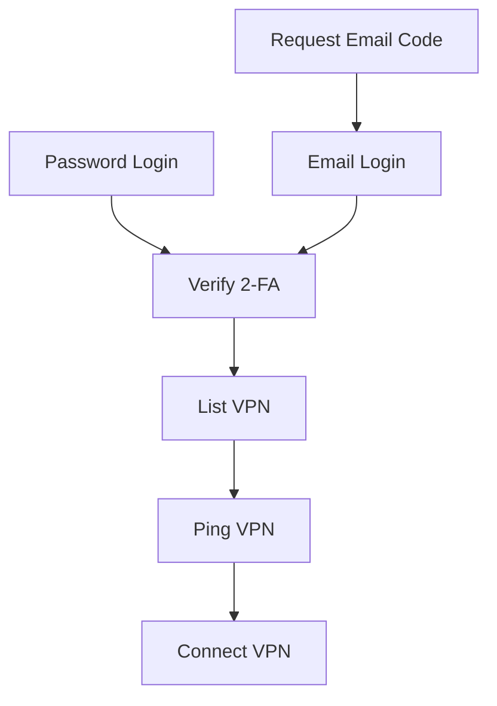
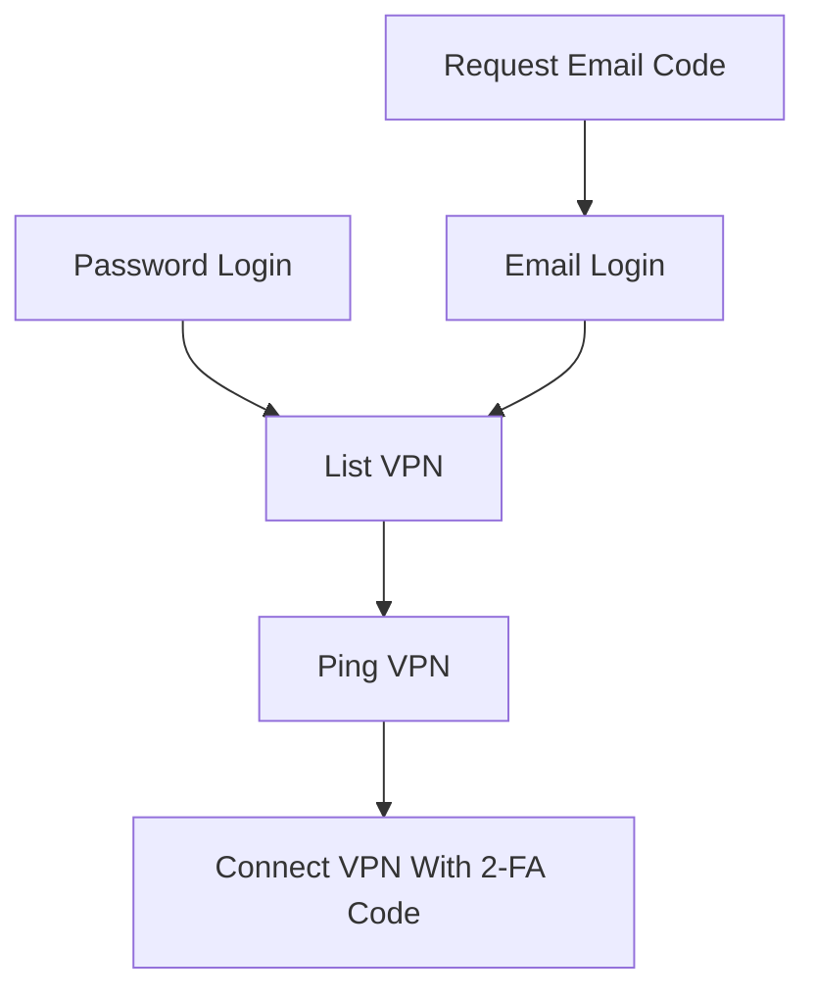

# corplink-rs

使用 rust 实现的 [飞连][1] 客户端，支持 Linux/Windows10/MacOS

# 安装

## 从 release 安装

下载 [release](https://github.com/PinkD/corplink-rs/releases) 中的安装包，并安装

目前支持:

- Linux
  - ArchLinux 有单独打包
  - 欢迎贡献其它包管理器的打包脚本
- MacOS
- Windows

## 安装 master/nightly 版本 

可以从 [nightly.link](https://nightly.link/PinkD/corplink-rs/workflows/release/master) 下载

## Docker 部署（dev，SOCKS5 代理）

需要 Docker Engine 和 Compose 插件。默认部署纯用户态 SOCKS5，容器以普通用户运行，
不需要 `/dev/net/tun`、`NET_ADMIN` 或 privileged。代理不会修改服务器系统路由。

### 拉取镜像和准备配置

CI 发布到 `ghcr.io/yanickxia/corplink-rs-dev`，一个标签同时提供 `linux/amd64` 和
`linux/arm64`，服务器拉取时自动选择架构。首次 CI 发布成功后，在 `dev` 分支仓库根目录执行：

```sh
docker compose pull

mkdir -p docker/data
cp docker/config.example.json docker/data/config.json
chmod 700 docker/data
chmod 600 docker/data/config.json
```

Compose 默认拉取 `ghcr.io/yanickxia/corplink-rs-dev:dev`。可在 `.env` 中设置
`CORPLINK_IMAGE=ghcr.io/yanickxia/corplink-rs-dev:6.6.0` 等已发布版本来固定镜像。
镜像只包含 Linux release 程序和运行库，不含本机配置、Cookie 或编译工具链。

GHCR 新包首次发布时默认是私有的。需要匿名拉取时，在 GitHub Packages 的包设置中
将其设为 Public；保留私有时，服务器先用拥有 `read:packages` 权限的 classic PAT 执行
`docker login ghcr.io`。CI 本身使用仓库的 `GITHUB_TOKEN`，不需要另配发布用 PAT。

编辑 `docker/data/config.json`，填写公司、账号、服务器地址和 SOCKS5 密码。示例使用
新版设备 SSO；`platform` 应改为服务器支持的登录方式。如果使用原有登录流程，删除
`login_flow` 并按下文配置 `platform`、`password` 等字段。已有可用配置也可以复制到此处，
同时复制相同 `interface_name` 的 Cookie 文件；设备信任所需的 `device_id`、`device_name`
应保持一致。容器配置必须保留：

```json
{
  "auto_setup_routes": false,
  "use_vpn_dns": false,
  "socks5_listen": "0.0.0.0:1080"
}
```

整个 `docker/data` 目录需可写：程序会回写设备密钥、登录状态，并在同目录保存
`corplink_cookies.json`。首次配置时，把运行用户的 UID/GID 写入仓库根目录 `.env`，
让容器使用与此目录相同的文件权限（如果已有 `.env`，只更新这两项）：

```sh
printf 'CORPLINK_UID=%s\nCORPLINK_GID=%s\n' "$(id -u)" "$(id -g)" > .env
```

建议用普通用户执行上述准备操作；也可以使用镜像默认的 `10001:10001`，并将
`docker/data` 的所有权赋给该 UID/GID。配置和 Cookie 不要只保存在容器可写层中。

### 首次登录和后台运行

```sh
docker compose up -d
docker compose logs --tail=100 corplink
docker compose attach corplink
```

在自己的电脑浏览器中打开终端显示的 SSO 地址，将完整回调地址粘贴回此终端，
按提示输入 MFA 验证码。服务器没有浏览器时出现“未能自动打开浏览器”是正常的。
连接成功后依次按 **Ctrl-P、Ctrl-Q** 脱离终端，容器继续运行。
`Ctrl-C` 会停止程序；不要同时启动两个使用同一配置目录的实例。

```sh
docker compose logs --tail=100 -f
docker compose stop
# 重新启动；若登录会话已过期，attach 后按提示完成认证
docker compose up -d
docker compose attach corplink
```

容器配置了自动重启和 30 秒正常退出时间。自动重启不替代 SSO/MFA；会话失效后仍需
人工登录。`tunnel_recovery` 默认不开启，需要时按下文填入自己的内网探测地址。

### 使用代理

默认只发布服务器的 `127.0.0.1:1080`，示例发布的是 TCP 代理端口：

```sh
curl --socks5-hostname 127.0.0.1:1080 --proxy-user 'proxy-user:你的密码' \
  https://你的内网域名/
```

`--socks5-hostname` 把域名解析交给 VPN 内的 DNS。客户端目标需要在 VPN 下发的路由
或配置的额外路由范围内。SOCKS5 UDP ASSOCIATE 使用动态 UDP 端口，此端口映射没有
提供 UDP 转发，不能通过再发布一个 `1080/udp` 来替代。

在自己的电脑使用服务器代理，可以建立 SSH 转发：

```sh
ssh -N -L 1080:127.0.0.1:1080 user@server
```

随后连接电脑上的 `127.0.0.1:1080`。需要局域网直接访问时，在 `.env` 中设置
`CORPLINK_BIND_ADDRESS=服务器的局域网IP`，可用 `CORPLINK_SOCKS_PORT` 修改宿主机端口，
再执行 `docker compose up -d`。直接开放代理时应设置 SOCKS5 账号密码并限制来源地址。
同一 Compose 网络内的其他容器可使用 `socks5h://corplink:1080` 并配置相同的代理账号密码，
无需接管系统路由。

### CI 发布规则

`.github/workflows/docker.yml` 使用原生 x86_64 和 ARM64 runner，分别运行 Linux
回归测试、非 root 容器检查及配置持久化检查。两个架构均通过后才合并并更新发布标签。
PR 只构建测试；推送 `dev` 或正式版本 tag 时发布到 GHCR。

| 触发条件 | 镜像标签 |
|---|---|
| 推送 `dev` | `dev`、`sha-完整commit` |
| 推送 `bytedance-6.6.0` 等正式版本 tag | `6.6.0`、`bytedance-6.6.0`、`latest`、`sha-完整commit` |

`latest` 只跟随正式版本 tag，`dev` 跟随开发分支。发布权限仅使用 `packages: write`；
镜像自动关联当前 GitHub 仓库。参考 [GHCR 权限与可见性说明](https://docs.github.com/en/packages/working-with-a-github-packages-registry/working-with-the-container-registry)。

### 更新和本地构建

服务器更新时执行：

```sh
docker compose pull
docker compose up -d --no-build
```

保留 `docker/data`，新容器会继续使用已有配置和会话。回滚时将 `.env` 中的
`CORPLINK_IMAGE` 改为之前的版本号或 SHA 标签，再执行上述命令。

需要自己构建时使用附加的 `compose.build.yaml`，在 Linux 内重编当前子模块和 Rust
程序；配置了 `CORPLINK_IMAGE` 时先将其改为 `corplink-rs-dev:local`：

```sh
git submodule update --init --recursive
docker compose -f compose.yaml -f compose.build.yaml build
docker compose -f compose.yaml -f compose.build.yaml up -d --no-build
```

在服务器本机构建会自动使用服务器架构。也可以在 Apple Silicon 上为 x86_64 服务器
构建并导出镜像（需要 Docker Buildx 和跨架构执行支持）：

```sh
docker buildx build --platform linux/amd64 --load -t corplink-rs-dev:local .
docker save corplink-rs-dev:local | gzip > corplink-rs-dev-amd64.tar.gz
# 复制到服务器后：
docker load < corplink-rs-dev-amd64.tar.gz
CORPLINK_IMAGE=corplink-rs-dev:local docker compose up -d --no-build
```

ARM64 服务器将平台替换为 `linux/arm64`。可通过 `docker build --target test .` 在
Linux 构建环境内运行 Rust 回归测试。Compose 的交互终端和端口配置见
[Docker Compose 服务说明](https://docs.docker.com/reference/compose-file/services/)。

## 手动编译

### linux/macos

```bash
git clone https://github.com/PinkD/corplink-rs --depth 1
cd corplink-rs
# build libwg
cd libwg
./build.sh
# if you are using Windows, you can clone and build libwg maunally
# ref: wireguard-go/Makefile:libwg

cargo build --release
# install corplink-rs to your PATH
mv target/release/corplink-rs /usr/bin/
```

### windows

**前提**: 需要 Go (≥1.22)、GCC (MinGW-w64)、make、Rust (GNU 工具链)。

安装工具链后，在 **PowerShell** 中执行：

```powershell
# 1. 构建 libwg（生成 libwg.a + libwg.h）
cd libwg
.\build.ps1

# 2. 构建 Rust 项目
cd ..
rustup toolchain install stable-gnu
rustup default stable-x86_64-pc-windows-gnu
cargo build --release
```

> 编译的 `build.ps1` 会调用 `make libwg`，该目标会以 `CGO_ENABLED=1` 编译 Go 代码。
> MinGW GCC 需要在 PATH 中，且 make 需要支持 bash 风格环境变量语法。
> 也可在 MSYS2 UCRT64 环境中执行 `./build.sh`（同样需要 Go + GCC）。

# 用法

> **该程序需要 root 权限来启动 `wg-go` (windows 上需要管理员权限)**

```bash
# direct
corplink-rs config.json
# systemd
# config is /etc/corplink/config.json
systemctl start corplink-rs.service
# auto start
systemctl enable corplink-rs.service

# systemd with custom config
# config is /etc/corplink/test.json
# NOTE: cookies.json is reserved by cookie storage
systemctl start corplink-rs@test.service
```

## windows 使用说明

### 快速开始（推荐使用预编译版本）

1. 从 [Releases](https://github.com/PinkD/corplink-rs/releases) 下载 `corplink-rs-*-windows.zip`
2. 解压到任意目录
3. 运行 `setup.ps1` 自动获取 `wintun.dll`：

```powershell
powershell -ExecutionPolicy Bypass -File setup.ps1
```

4. 编辑 `config.json`，填入公司代码和登录信息（见下方配置文件实例）
5. 以**管理员身份**打开 PowerShell，运行：

```powershell
.\corplink-rs.exe config.json

# 调试模式
$env:RUST_LOG="debug"; .\corplink-rs.exe config.json
```

### wintun.dll 说明

`corplink-rs` 依赖 [Wintun][6] 虚拟网卡驱动来创建 WireGuard 隧道。由于 Wintun 的许可证要求用户从[官网][6]直接获取，我们无法在 release 包中附带该文件。

`setup.ps1` 脚本会自动从 `wintun.net` 下载并解压 `amd64` 版本的 `wintun.dll` 到当前目录。

手动获取：访问 [wintun.net][6]，下载 zip 包，将 `bin/amd64/wintun.dll` 复制到 `corplink-rs.exe` 所在目录。

### 管理员权限

程序需要管理员权限，原因：
- `wg-go` 需要创建 TUN 虚拟网卡
- 配置系统路由表（自动添加 VPN 路由）

如果运行时提示 `please run as administrator`，右键 PowerShell 选择"以管理员身份运行"。

### 常见问题

- **wintun.dll 找不到**：运行 `setup.ps1` 或手动下载放入同目录
- **配置文件 JSON 不支持注释**：示例中的 `// comment` 需要删除
- **路由未生效**：检查是否以管理员运行，关闭其他 VPN 软件避免路由冲突

## macos 特殊说明

macos 要求 tun 设备的名称满足正则表达式 `utun[0-9]*` ，因此需要将配置文件中的 `interface_name` 改为符合正则的名字，例如 `utun12345`  
另外， `utun` 后的数字类型应该是 `int16` ，如果大于 `32767` 会报错 `Failed to create TUN device: invalid argument` 。具体参考 [#46](https://github.com/PinkD/corplink-rs/issues/46)

## log level 配置

本项目使用 [env_logger](https://docs.rs/env_logger/latest/env_logger/) 作为 log 库，修改 log level 需要使用环境变量，示例：

```bash
RUST_LOG=debug ./corplink-rs config.json
```

# 配置文件实例

最小配置

```json
{
  "company_name": "company code name",
  "username": "your_name"
}
```

推荐配置(自用配置)

```json
{
  "company_name": "company code name",
  "username": "your_name",
  "password": "your_pass",
  "platform": "ldap"
}
```

完整配置

```json
{
  "company_name": "company code name",
  "username": "your_name",
  // support sha256sum hashed pass if you don't use ldap, will ask email for code if not provided
  "password": "your_pass",
  // default is feilian, can be feilian/ldap/lark(aka feishu)/OIDC
  // dingtalk/aad/weixin is not supported yet
  "platform": "ldap",
  "code": "totp code",
  // default is DollarOS(not CentOS)
  "device_name": "any string to describe your device",
  "device_id": "md5 of device_name or any string with same format",
  "public_key": "wg public key, can be generated from private key",
  "private_key": "wg private key",
  "server": "server link",
  // enable wg-go log to debug uapi problems
  "debug_wg": true,
  // will use corplink as interface name
  "interface_name": "corplink",
  // will use the specified server to connect, for example 'HK-1'
  // name from server list
  "vpn_server_name": "hk",
  // latency/default
  // latency: choose the server with the lowest latency
  // default: choose the first available server
  "vpn_select_strategy": "latency",
  // use vpn dns (macOS: networksetup; Linux: rename /etc/resolv.conf aside
  //   and write a new one with the VPN-provided nameserver)
  // NOTE: if process doesn't exit gracefully, your dns may not be restored
  "use_vpn_dns": false,
  // optional: filename for the Linux backup of /etc/resolv.conf.
  // Default "resolv.conf.corplink", always placed next to /etc/resolv.conf.
  // macOS ignores this field.
  "dns_backup_filename": null,
  // automatically setup system routes (default: true)
  // set to false if you want to manually configure routes
  "auto_setup_routes": true,
  // route mode: "split" (default) or "full"
  // - split: use intranet routes from server (same as official split mode)
  // - full:  use full-tunnel routes from server
  //          often combined with "auto_setup_routes": false in container/gateway setups
  "route_mode": "split",
  // optional CIDRs added to the server-provided routes before filtering. unlike
  // vpn_allowed_routes, this can introduce networks not covered by server routes.
  // the combined routes are still subject to the allowlist and denylist below.
  "vpn_additional_routes": ["20.205.243.160/28"],
  // optional exact hostnames resolved on every VPN connection/reconnection.
  // each IPv4 result is appended as a /32 route; IPv6 results are appended as
  // /128 routes only when the server assigns an IPv6 tunnel address.
  "vpn_additional_domains": ["github.com", "api.github.com"],
  // optional strict CIDR whitelist. each entry is intersected with the routes
  // returned by the server plus the additional routes above. an empty list allows
  // no routes; missing/null preserves all routes. when both lists are set,
  // vpn_disallowed_routes is subtracted after this whitelist. the allowlist must
  // also cover every additional route that should be retained, so leave it unset
  // when using domain routes whose resolved addresses are not known in advance.
  // "vpn_allowed_routes": ["192.168.2.0/24"],
  // optional: list of CIDRs to carve out of AllowedIPs (and system routes).
  // applied as CIDR subtraction: each entry is subtracted from every route
  // returned by the server, so listing a smaller range like "10.68.0.0/16"
  // still punches a hole even when the server returns a supernet like
  // "0.0.0.0/0" (full-tunnel). useful for keeping local LAN traffic off the
  // VPN, and for excluding the VPN peer endpoint IP to avoid a routing loop
  // that would otherwise black-hole all traffic.
  "vpn_disallowed_routes": ["192.168.1.0/24"],
  // optional: expose SOCKS5 alongside system routes using the same VPN tunnel.
  // set auto_setup_routes=false for userspace-only SOCKS5 without root or
  // system interface/routes/DNS changes.
  // supports TCP CONNECT and UDP ASSOCIATE; hostnames are resolved in-tunnel.
  "socks5_listen": "0.0.0.0:1080",
  // optional: require SOCKS5 username/password auth (RFC 1929) on the proxy.
  // when socks5_username is empty/unset, the proxy accepts connections with no auth.
  "socks5_username": "user",
  "socks5_password": "pass",
  // optional: force the WireGuard transport ("udp" or "tcp") instead of the
  // server-advertised protocol_mode. some protocol_mode=1 (tcp) gateways also accept
  // WireGuard over UDP -- the server even ships a protocol_detect_config (udp<->tcp switch
  // thresholds) for them in /api/vpn/list. since WireGuard-over-TCP can collapse to a few
  // KB/s on a lossy uplink (TCP-over-TCP), forcing "udp" can be far faster there.
  // leave unset to follow the server's protocol_mode (1 => tcp, otherwise udp).
  "force_protocol": "udp",
  // poll the TPS auth result until approval (5s interval, 180s timeout) instead
  // of waiting for Enter; opt-in because some servers invalidate the auth
  // ticket on the first check. applies to every TPS platform (lark/oidc/weixin/...)
  "poll_tps_auth": false,
  // account type sent in the feilian_v1 login request ("userid" by default).
  // deployments whose login setting advertises another account type (e.g. "email")
  // can override it here
  "account_type": "userid",
  // preview: opt-in corplink-web-style availability detection and recovery.
  // The block being absent keeps the stable 6.5.2 lifecycle. An empty object
  // enables defaults; override the URLs when code.byted.org is not the correct
  // tunnel-only target for your company.
  "tunnel_recovery": {
    "enabled": true,
    "tunnel_probe_url": "https://code.byted.org/",
    // Defaults to the configured CorpLink server. In full-tunnel mode, choose
    // a URL/IP excluded from AllowedIPs so this really tests underlay.
    "underlay_probe_url": "https://corplink.example.com/",
    "initial_delay_secs": 10,
    "probe_interval_secs": 5,
    "probe_timeout_secs": 5,
    "handshake_stale_secs": 180,
    "min_failures": 3,
    "min_failure_window_secs": 30,
    "reset_gap_secs": 90,
    "repair_delay_secs": 10,
    "repair_timeout_secs": 6,
    "repair_validation_secs": 30,
    "rebuild_cooldown_secs": 600
  }
}
```

## 新版 SSO 设备登录

支持 Android 3.3.23 使用的 PKCE 设备登录流程。配置 `"login_flow": "device"`，
并把 `platform` 设为服务器提供的登录方式，例如 `bytedance_sso` 或 `lark`。
省略 `login_flow` 时继续使用旧流程。

```json
{
  "company_name": "company code name",
  "username": "your_name",
  "server": "https://your-corplink-server.example.com",
  "login_flow": "device",
  "platform": "bytedance_sso",
  "device_id": "your registered device id",
  "device_name": "your registered device name",
  "interface_name": "fresh-login",
  "socks5_listen": "127.0.0.1:15323",
  "auto_setup_routes": false,
  "state": "Init"
}
```

运行后程序会打开浏览器。完成 SSO 授权后，复制地址栏中
`/multiple-pages/device-callback.html?...` 的完整地址并粘贴到终端；
也接受 `corplink://login/callback?...` 地址。若浏览器提示打开飞连，可取消提示后复制地址。
回调地址仅供本次登录使用，请及时粘贴，不要分享或写入配置文件。

如果服务器要求二次验证，程序优先发送邮箱验证码，其次支持短信和动态验证码。
按终端提示输入验证码后，程序获取 OTP 并保存新会话，再连接 VPN。
未完成 MFA 或服务器要求其他尚不支持的步骤时，程序会停止，配置不会标记为已登录。
此流程仍须满足企业的账号、设备信任和二次验证要求。

从头测试时，使用独立目录或独立 `interface_name`，设 `state` 为 `Init`，
清空 `code`，并确保对应的 `<interface_name>_cookies.json` 不存在。
纯 SOCKS5 模式（`auto_setup_routes=false`）无需 sudo，也不会改系统路由或 DNS。

## CorpLink request profile

The VPN control plane follows the community Linux client profile: list/connect
use CorpLink 3.3.17 build 8135 and are signed. Connect also sends `jwt-token`
from the same `vpn-token` Cookie snapshot used to compute the signature.
Ping and the best-effort disconnect report use the minimal Android-v2 query and
are unsigned. The client
does not send periodic `/vpn/report` requests; tunnel liveness is determined by
WireGuard handshakes and persistent keepalive.

## SOCKS5 / netstack 模式

`socks5_listen` 控制是否监听 SOCKS5；`auto_setup_routes` 独立控制是否自动安装系统路由：

| `socks5_listen` | `auto_setup_routes` | 行为 |
|---|---|---|
| 未设置 | `true` / `null` / 未设置 | 创建 TUN，自动安装路由 |
| 未设置 | `false` | 创建 TUN，路由由用户配置 |
| 已设置 | `true` / `null` / 未设置 | 创建 TUN、自动安装路由，同时提供 SOCKS5 |
| 已设置 | `false` | 纯用户态 SOCKS5，不创建系统 TUN 或安装路由 |

系统 TUN 与 SOCKS5 共用一个 WireGuard 连接。SOCKS5 出站连接绑定到 VPN 网卡，
只允许访问 WireGuard AllowedIPs 范围内的目标，域名通过 VPN 提供的 DNS 解析。
系统路由模式需要 root / 管理员权限，系统 DNS 由 `use_vpn_dns` 控制。

如果需要原来的免 root 纯代理模式，请显式设置 `auto_setup_routes=false`。
这种模式使用 [wg-go][2] 的 gVisor netstack：

- **无需 root / 不改系统路由和 DNS / 不建网卡**，适合容器、无权限环境或只想给单个应用走 VPN 的场景
- 支持 TCP `CONNECT` 和 UDP `ASSOCIATE`，域名在隧道内解析（用 `--socks5-hostname` 让客户端把 DNS 也交给代理）
- 可选用户名/密码认证（RFC 1929）：设置 `socks5_username`（及 `socks5_password`）即开启；留空则免认证

```sh
# 例：通过代理访问内网
curl --socks5-hostname user:pass@127.0.0.1:1080 https://intranet.example.com/
```

纯用户态模式下，`interface_name` 用于区分 Cookie 文件，不创建系统网卡；`use_vpn_dns` 不改变系统 DNS。

## Preview tunnel recovery

`preview/tunnel-recovery` 分支新增一套显式启用的恢复监督器。它同时检查最近的
WireGuard 握手年龄和必须经过隧道的 HTTP 请求；只有两个信号都至少失败 3 次、
失败窗口达到 30 秒，且控制面/underlay 仍可访问时，才会接受恢复请求。

恢复会先等待 10 秒，通过 UAPI 重新打开当前 WireGuard UDP/TCP bind 并重设 peer
endpoint，再主动验证最多 30 秒。仍未恢复时，它先清理 TUN/DNS，再用同一份配置、
Cookie、device ID 和 WireGuard key `exec` 一个全新进程。完整重建在 `exec` 前后共享
10 分钟冷却预算，持续故障不会造成重启风暴；underlay 也不可用时则保留当前隧道。

SOCKS5/netstack 模式下，隧道 HTTP 探测自动通过本机 SOCKS5 监听，并使用远端 DNS
（`socks5h`）；内核 TUN 模式沿用 AllowedIPs/系统路由。在 full-tunnel 模式下，要让
underlay 判断可信，应通过 `vpn_disallowed_routes` 明确排除 underlay 探测地址。

# 原理和分析

[飞连][1] 是基于 [wg-go][2] 魔改的企业级 VPN 产品

## 配置原理

魔改了配置的方式，加了鉴权

猜测是：
- 动态管理 peer
- 客户端通过验证后，使用 public key 来请求连接，然后服务端就将客户端的 key 加到 peer 库里，然后将配置返回给客户端，等待客户端连接
    - wg 是支持同一个接口上连多个 peer ，所以这样是 OK 的
- 定时将不活跃的客户端清理，释放分配的 IP
- ...

因此，我们只需要生成 wg 的 key ，然后去找服务端拿配置，然后写到 wg 配置里，启动 wg ，就能连上服务端了

### 后续改动

2.0.9 版本(或者更早)新增了 `protocol_version` 字段，需要使用魔改后的 [wg-corplink][5] 才能连接

## 请求流程


### Linux



### Android



## otp 实现

飞连的 otp 是使用的标准的 [totp][1] ，在 ua 为 Android 时，会在登录时返回 totp 的 token ，然后使用 totp 算法就能生成出当前时间的验证码了，然后在获取连接信息时传输该验证码，就不需要单独验证验证码了

# TODO

- [ ] 使用 [Tauri][7] 实现界面(~~或许大概可能永远不会有~~)
  - 参考实现：https://github.com/huangzheng2016/ecorplink
- [x] 实现 TCP 版的 wg 协议
- [x] 为不同配置生成不同的 `cookies.json`
- [x] windows/mac 实现
- [x] 自动使用从服务器返回的请求中的时间戳同步时间
- [x] 自动生成 wg key
- [x] 修复服务端异常断开连接后客户端不会退出的问题

# Changelog

- 6.1.0
  - support configurable Android client profiles
- 0.5.6
  - add request signing support (@fuergaosi233 @lmxx1234567)
- 0.5.5
  - add more route configs(@yanickxia @zier-one @kfxhjz @ZeppLu)
  - support protocol override config(@n-WN)
  - usermode proxy with socks5(@wilinz)
  - minor fix(@Ben8368 @huangzheng2016)
- 0.5.4
  - fix memory leak in unsafe code
  - refactor error handling with `anyhow`
  - fix default log level
  - add ci for push event(@yanyongyu)
- 0.5.3
  - remove keep-alive api call
- 0.5.2
  - add ipv6 support(@hexchain @ManiaciaChao)
- 0.5.1
  - support using dns from server for macos(@fanwenlin)
  - fix high cpu usage
- 0.5.0
  - add tcp support for wg-go
- 0.4.4
  - add macos release(by @overvenus)
  - fix single ip route(by @simpleapples)
  - add qr code suuport for feishu login(@simpleapples)
- 0.4.3
  - support corplink 2.2.x(by @jixiuf)
- 0.4.2
  - add OIDC platform support(by @Jinxuyang)
- 0.4.1
  - fix Windows device up
  - fix undefined behavior for c str
- 0.4.0
  - embed wg-go with cgo
- 0.3.6
  - fix wg-corplink not exit(by @LionheartLann)
  - fix session is expired(by @XYenon)
- 0.3.5
  - fix empty login method list
  - fix write long data to uapi(by @nolouch)
  - add vpn server name option(by @nolouch)
- 0.3.4
  - fix cookie out of date
- 0.3.3
  - add feishu tps login support
  - upgrade dependency
- 0.3.2
  - separate `cookies.json`
  - add debug flag for wg-go
- 0.3.1
  - fix mac support(on [wg-corplink][5])
- 0.3.0
  - add windows/mac support
- 0.2.3
  - fix empty `protocol_version`
  - add privilege check
- 0.2.2
  - fix wg-corplink not exit if corplink-rs exit accidently
- 0.2.1
  - use modified wireguard-go
    - don't generate config anymore
  - remove `conf_name/conf_dir` and add `interface_name/wg_binary` in config
- 0.1.4
  - get company name from company code automatically
  - support ldap
  - check and skip tcp wg server
  - optimize config
- 0.1.3
  - disconnect if wireguard handshake timeout
- 0.1.2
  - support time correction for totp
- 0.1.1
  - support generate wg key
- 0.1.0
  - first version

# 参考链接

- [wg-go][2]
- [totp][3]
- [python 版本][4]
- [wg-corplink][5]
- [wintun][6]
- [Tauri][7]

# License

```license
 Copyright (C) 2022-2026  PinkD
 Other contributors: https://github.com/PinkD/corplink-rs/graphs/contributors

    This program is free software; you can redistribute it and/or
    modify it under the terms of the GNU General Public License
    as published by the Free Software Foundation; either version 2
    of the License, or (at your option) any later version.

    This program is distributed in the hope that it will be useful,
    but WITHOUT ANY WARRANTY; without even the implied warranty of
    MERCHANTABILITY or FITNESS FOR A PARTICULAR PURPOSE.  See the
    GNU General Public License for more details.

    You should have received a copy of the GNU General Public License
    along with this program; if not, write to the Free Software
    Foundation, Inc., 51 Franklin Street, Fifth Floor, Boston, MA  02110-1301, USA.
```


[1]: https://www.volcengine.com/product/vecorplink
[2]: https://github.com/WireGuard/wireguard-go
[3]: https://en.wikipedia.org/wiki/Time-based_one-time_password
[4]: https://github.com/PinkD/corplink
[5]: https://github.com/PinkD/wireguard-go
[6]: https://www.wintun.net/
[7]: https://github.com/tauri-apps/tauri
